<p align="center">
   whoami — António (0xBerk), red team and offensive development. CPTS, CRTO completed; ODPC, ARTOC in progress." width="100%"/>
</p>

I work on the offensive side: compromising Active Directory environments and writing the tooling to do it quietly. I care more about understanding why an attack path works than about reaching the flag.

## TTPs

What I've practised, mapped to MITRE ATT&CK, with the code or write-up that backs it.

| Tactic | Technique | ATT&CK | Proof of work |
|---|---|---|---|
| Credential Access | Kerberoasting | `T1558.003` | [Administrator](https://0xberk0.github.io/posts/Administrator-htb-writeup/) |
| Credential Access | AS-REP Roasting | `T1558.004` | [Blackfield](https://0xberk0.github.io/posts/blackfield-writeup/) |
| Credential Access | AD CS abuse (ESC1–ESC8) | `T1649` | [Certified](https://0xberk0.github.io/posts/certified-htb-writeup/) |
| Credential Access | DCSync | `T1003.006` | [Administrator](https://0xberk0.github.io/posts/Administrator-htb-writeup/) |
| Privilege Escalation | Kerberos delegation / RBCD | `T1558` | [Support](https://0xberk0.github.io/posts/support-htb-writeup/) |
| Privilege Escalation | ACL abuse | `T1098` | [Administrator](https://0xberk0.github.io/posts/Administrator-htb-writeup/) · [Certified](https://0xberk0.github.io/posts/certified-htb-writeup/) |
| Discovery | Attack path analysis with BloodHound | `T1087.002` | |
| Lateral Movement | Remote services, pivoting & tunneling | `T1021` · `T1572` | |
| Command & Control | Cobalt Strike operations | `TA0011` | |
| Defense Evasion | Process hollowing | `T1055.012` | [process-injection-process-hollowing](https://github.com/0xBerk0/process-injection-process-hollowing) |
| Defense Evasion | Early Bird APC injection | `T1055.004` | [process-injection-early-bird](https://github.com/0xBerk0/process-injection-early-bird) |
| Defense Evasion | Injection from PE resources | `T1055` | [process-injection-using-resources](https://github.com/0xBerk0/process-injection-using-resources) · [classic-process-injection](https://github.com/0xBerk0/classic-process-injection) |
| Defense Evasion | Dynamic API resolution (hashing, PEB/EAT walking) | `T1027.007` | [dynamic-imports-with-hashing](https://github.com/0xBerk0/dynamic-imports-with-hashing) · [peb-walker](https://github.com/0xBerk0/peb-walker) · [export-address-table-walker](https://github.com/0xBerk0/export-address-table-walker) |
| Execution | Indirect syscalls · Halo's Gate | `T1106` | [indirect-syscalls](https://github.com/0xBerk0/indirect-syscalls) · [HalosGate-research](https://github.com/0xBerk0/HalosGate-research) |
| Discovery | Userland hook detection | `T1518.001` | [windows-api-hook-finder](https://github.com/0xBerk0/windows-api-hook-finder) |

## Latest write-ups

<!-- BLOG-POST-LIST:START -->
- [Certified Htb Writeup](https://0xberk0.github.io/posts/certified-htb-writeup/) — Aug 2026
- [HackTheBox — Monteverde](https://0xberk0.github.io/posts/monteverde-writeup/) — Aug 2026
- [HackTheBox — Blackfield](https://0xberk0.github.io/posts/blackfield-writeup/) — Jun 2026
- [HackTheBox — Administrator](https://0xberk0.github.io/posts/Administrator-htb-writeup/) — Jun 2026
- [HTB Support Writeup](https://0xberk0.github.io/posts/support-htb-writeup/) — Jun 2026
<!-- BLOG-POST-LIST:END -->

Every machine documented end to end, dead ends included → **[0xberk0.github.io](https://0xberk0.github.io)**

## Toolkit

```text
lang     C · C++ · C# · Python · PowerShell · Go · Bash
ad       BloodHound · Impacket · Rubeus · Certipy · Mimikatz · PowerView
c2       Cobalt Strike
web/net  Nmap · Burp Suite · Metasploit · SQLMap · ffuf
```

---

<sub>All code is for research and authorized testing only. &nbsp;·&nbsp; struggle. adapt. understand.</sub>
