  

Red team operator from Portugal. I break Active Directory environments and write my own tooling in C/C++ to do it without getting caught.

| | | |
|---|---|---|
| `AD` | Kerberoasting · AS-REP · RBCD · AD CS · ACL abuse · DCSync · Cobalt Strike | [write-ups](https://0xberk0.github.io) |
| `DEV` | process injection · indirect syscalls · Halo's Gate · API hashing · hook detection | [repos](https://github.com/0xBerk0?tab=repositories&language=c) |

### `> latest write-ups`

<!-- BLOG-POST-LIST:START -->
- [Certified Htb Writeup](https://0xberk0.github.io/posts/certified-htb-writeup/) — Aug 2026
- [HackTheBox — Monteverde](https://0xberk0.github.io/posts/monteverde-writeup/) — Aug 2026
- [HackTheBox — Blackfield](https://0xberk0.github.io/posts/blackfield-writeup/) — Jun 2026
- [HackTheBox — Administrator](https://0xberk0.github.io/posts/Administrator-htb-writeup/) — Jun 2026
- [HTB Support Writeup](https://0xberk0.github.io/posts/support-htb-writeup/) — Jun 2026
<!-- BLOG-POST-LIST:END -->

research & authorized testing only · struggle. adapt. understand.
